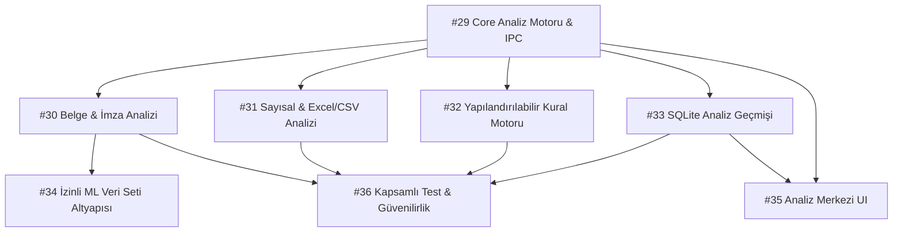

# 📋 TEMİN 360 — v1.5.0 Sürüm Planı ve Mimari Yol Haritası

**Milestone:** [v1.5.0 — Gelişmiş Analiz ve Belge Yönetimi](https://github.com/ilyasbozdemir/workdesk-360/milestone/4)  
**Hedef Kapsam:** Harici yapay zekâ (Cloud LLM) bağımlılığı olmadan, kamu kurumlarının yerel/hava boşluklu (air-gapped) bilgisayarlarında çalışan, çevrimdışı, deterministik veri ve belge analiz altyapısı.

---

## 📌 Sürüm Sınırları ve Mimari Ayrım

| Sürüm | Odak & Kapsam | Temel Çıktılar | Durum |
|---|---|---|---|
| **v1.0.0 Stable** | Kararlı Temel Uygulama & İhale İş Akışları | Şablon çıktısı (PDF/DOCX/Paged.js), EKAP aktarımı (#6), Dosya Sihirbazı (#9), Kanban paneli (#11). | Geliştirme son aşamada |
| **v1.5.0** | Yerel Analiz ve Belge Denetim Motoru | Offline kural tabanlı analiz motoru, imza/onay denetimi, sayısal aykırı değer/KDV analizi, SQLite tarihçesi, Analiz Merkezi UI (#29 - #36). | **Planlandı (Aktif)** |
| **v2.0.0** | Bulut SDK & Çoklu Veritabanı Mimarisi | Ortak SDK (`@dt/core`), PostgreSQL/MySQL sağlayıcıları, çift yönlü offline-first senkronizasyon (#19). | Gelecek Sürüm |

---

## 🏗️ v1.5.0 Issue Listesi ve İş Kırılımı

| Issue # | Başlık | Modül | Öncelik | Bağımlılık |
|---|---|---|---|---|
| **[#29](https://github.com/ilyasbozdemir/workdesk-360/issues/29)** | `feat(core-analysis): yerel analiz motoru mimarisi ve tip güvenli ipc sözleşmesi` | Main / Core | 🔴 Yüksek (Temel) | Yok |
| **[#30](https://github.com/ilyasbozdemir/workdesk-360/issues/30)** | `feat(document-analysis): belge alan çıkarımı ve imza durumu doğrulayıcı modülü` | Main / Docs | 🔴 Yüksek | #29, #16 |
| **[#31](https://github.com/ilyasbozdemir/workdesk-360/issues/31)** | `feat(data-analysis): excel ve csv sayısal veri, fiyat ve aykırı değer analiz modülü` | Main / Domain | 🟡 Orta | #29 |
| **[#32](https://github.com/ilyasbozdemir/workdesk-360/issues/32)** | `feat(rule-engine): belge ve alım türüne göre yapılandırılabilir analiz kural motoru` | Domain | 🟡 Orta | #29 |
| **[#33](https://github.com/ilyasbozdemir/workdesk-360/issues/33)** | `feat(audit-log): sqlite analiz geçmişi, bulgu ilişkilendirme ve karşılaştırmalı raporlama` | Database | 🟡 Orta | #29 |
| **[#34](https://github.com/ilyasbozdemir/workdesk-360/issues/34)** | `feat(ml-dataset): yerel modelleme için izinli örnek etiketleme ve veri seti yönetim altyapısı` | Main / ML | 🟢 Düşük (Hazırlık) | #30 |
| **[#35](https://github.com/ilyasbozdemir/workdesk-360/issues/35)** | `feat(renderer): analiz merkezi arayüzü ve bulgu yönetim paneli` | Renderer UI | 🟡 Orta | #29, #33 |
| **[#36](https://github.com/ilyasbozdemir/workdesk-360/issues/36)** | `test(analysis): yerel analiz motoru ve belge kuralları kapsamlı test paketi` | QA / Testing | 🔴 Yüksek | #29, #30, #31, #32, #33 |

---

## 🔄 Bağımlılık ve Uygulama Sırası

---

## 🔒 Güvenlik, Gizlilik ve Çevrimdışı Çalışma İlkeleri

1. **Sıfır Bulut Bağımlılığı:** v1.5.0 analiz motoru çalışırken harici bir sunucuya veya LLM API'sine (OpenAI, Gemini vb.) ağ isteği göndermez.
2. **KVKK / PII Koruması:** Kullanıcı onayıyla etiketlenen belgelerde TCKN, IBAN, telefon ve kişi adları otomatik olarak maskelenir.
3. **Deterministik Sonuçlar:** Aynı kural seti ve aynı belge girildiğinde her zaman birebir aynı bulgular ve güven puanları üretilir.
